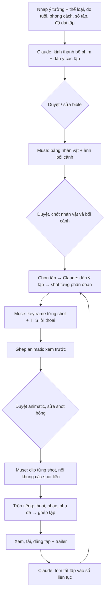

# Tính năng: Làm phim hoạt hình nhiều tập

Cập nhật: 2026-10-12 (rà soát lần 2). Trạng thái: **đề xuất, chưa làm.** Đã chốt: kênh tiếng Anh cho trẻ em (độ tuổi chọn khi tạo phim, mặc định 6–12), 2D anime, 16:9, YouTube chính + Facebook. Danh sách việc ở [tasks.md](tasks.md); hệ thống hiện tại ở [thiet-ke.md](thiet-ke.md).

## 1. Yêu cầu

- **Mục tiêu:** kênh hoạt hình **tiếng Anh cho trẻ em** (độ tuổi chọn khi tạo phim, mặc định 6–12), nhắm người xem quốc tế. Đăng chính lên **YouTube**, đăng thêm lên **Trang Facebook**. Khung **16:9**, phong cách **2D anime** kiểu phim truyền hình.
- **Đầu vào:** một ý tưởng (vài câu, tiếng Việt hay tiếng Anh đều được), ví dụ "Chú mèo béo mở tiệm bánh, mỗi tập gặp một vị khách kỳ lạ và học một điều tốt". Mọi nội dung đầu ra (kịch bản, lời thoại, phụ đề, tiêu đề, mô tả) bằng tiếng Anh.
- **Đầu ra:** một **bộ phim** nhiều **tập**, mỗi tập khoảng **5 phút**, gồm: kế hoạch cả bộ, thiết kế nhân vật và bối cảnh, kịch bản từng tập, các cảnh phim (ảnh + clip chuyển động), lồng tiếng / phụ đề / nhạc, video tập hoàn chỉnh.
- **Chạy ngầm:** bấm một lần, app tự làm các bước; người dùng chỉ duyệt ở vài điểm chốt.

## 2. Phân tích

### 2.1. Một tập 5 phút lớn cỡ nào

| Mục | Ước lượng |
| --- | --- |
| Shot mỗi tập | 300 giây ÷ 5–7 giây ≈ **45–60 shot** |
| Ảnh khung hình (keyframe) | 45–60 ảnh, cộng 20–30% tạo lại |
| Clip Muse | 45–60 clip (shot dài hơn 10 giây làm nhiều đoạn nối nhau, đã có sẵn trong app) |
| Lời thoại | khoảng 40–80 câu, 3–6 nhân vật |
| Thời gian chạy ngầm | **vài giờ mỗi tập**: Muse làm mỗi clip vài phút, chạy tối đa `MUSE_MAX_TABS` việc cùng lúc. Con số chính xác phải đo ở giai đoạn thử (mục 7, 8). |

**Độ dài tập chọn khi tạo phim** (mặc định 5 phút, cho chọn 3–10 phút). YouTube chỉ cho chèn **quảng cáo giữa video với video từ 8 phút**, nên tập ngắn kiếm tiền chủ yếu nhờ quảng cáo đầu video và nhờ **video tổng hợp** dài (mục 3).

So với video affiliate (5–8 cảnh), một tập phim lớn gấp khoảng 8–10 lần. Vì vậy cần: chia nhỏ việc, chạy song song có giới hạn, làm tiếp được khi lỗi giữa chừng, và **xem trước rẻ trước khi tốn Credits làm clip**.

### 2.2. Bài toán khó nhất: nhân vật giống nhau qua mọi cảnh

Mỗi lần AI tạo ảnh là một lần "vẽ lại", nên nhân vật dễ đổi mặt, đổi màu áo, đổi tỉ lệ. Cách giải:

1. **Ảnh chính + bảng nhân vật:** mỗi nhân vật có **một ảnh chính** (toàn thân, chính diện, nền trơn) và **một bảng nhân vật** (mặt trước, nghiêng, sau, vài biểu cảm), cùng phong cách vẽ. Người dùng duyệt rồi **chốt**. Khi tạo shot gửi kèm ảnh chính (rõ nhất); bảng nhân vật chỉ gửi khi shot cần góc nghiêng / sau, vì ảnh nhiều ô dễ làm AI vẽ lẫn nhiều hình trong một khung.
2. **Mô tả cố định:** mỗi nhân vật có một đoạn mô tả ngoại hình bằng tiếng Anh, dán nguyên văn vào mọi prompt có nhân vật đó.
3. **Ảnh tham chiếu:** mỗi prompt ảnh shot gửi kèm bảng của các nhân vật có mặt và ảnh bối cảnh đã chốt (cách app đang gửi ảnh sản phẩm + người mẫu).
4. **Phong cách cố định cho cả bộ:** một câu style dán vào mọi prompt; mặc định 2D anime kiểu phim truyền hình (mục 9). Không dùng tên hãng phim hay nhân vật có bản quyền.
5. **Nối khung:** shot liền nhau cùng một cảnh lấy khung cuối clip trước làm khung đầu clip sau (đã có trong chế độ "một cảnh quay liền").
6. **Giới hạn nhân vật mỗi shot:** tối đa 2–3 nhân vật trong một khung, vì càng nhiều thì càng dễ sai.

**Cần thử thật trước** (giai đoạn 0): Muse giữ một nhân vật giống nhau được qua bao nhiêu shot.

### 2.3. Âm thanh

| Phần | Cách làm | Ghi chú |
| --- | --- | --- |
| Lời thoại | **A.** Muse tự lồng tiếng trong clip (như chế độ "người mẫu nói" hiện nay) | Có khớp khẩu hình, nhưng giọng mỗi clip một kiểu, khó giữ một giọng cho một nhân vật |
| | **B.** TTS tiếng Anh chạy trong dịch vụ `audio` (miễn phí, chạy CPU), mỗi nhân vật một giọng cố định. Ứng viên: **Kokoro-82M** (giấy phép Apache-2.0, dùng thương mại được, nhiều giọng Anh-Mỹ / Anh-Anh, chạy nhanh trên CPU) | Giọng ổn định qua các tập, nhưng không khớp khẩu hình. Giọng trẻ con ít, có thể nâng cao độ (pitch) giọng nữ / nam trẻ. Kiểm tra lại giấy phép từng giọng ở F0 |
| | **C.** Người dẫn chuyện + phụ đề, nhân vật ít thoại | Dễ nhất, hợp truyện cổ tích / thiếu nhi |
| Nhạc nền | Thư viện nhạc của người dùng (trang Âm thanh), chọn theo tâm trạng từng cảnh | Phải là nhạc có quyền dùng |
| Phụ đề | Tạo từ lời thoại: tải file phụ đề tiếng Anh (`.srt`) lên YouTube thay vì in chữ lên hình, để người xem bật / tắt và YouTube tự dịch sang ngôn ngữ khác | Có thể thêm phụ đề các tiếng khác sau |

**Đề xuất:** dùng **B + C**: dẫn chuyện và thoại bằng Kokoro, mỗi nhân vật một giọng cố định; clip Muse làm miệng nhân vật mấp máy khi có thoại (không cần khớp từng chữ, hoạt hình TV cũng vậy). Dùng **A** cho vài shot quan trọng khi người dùng chọn. Tiếng Anh cho trẻ em: câu ngắn, từ đơn giản, nói chậm và rõ.

### 2.4. Claude viết nội dung dài

Claude CLI có giới hạn thời gian mỗi lần gọi (`CLAUDE_CLI_TIMEOUT`), nên **không viết cả tập trong một lần**:

1. **Kinh thánh của bộ phim (series bible):** tên phim, logline, thể loại, khán giả, giọng điệu, phong cách hình ảnh, thế giới, nhân vật, bối cảnh, dàn ý N tập. Một lần gọi.
2. **Dàn ý tập:** 8–12 phân đoạn (sequence), mỗi phân đoạn có bối cảnh, nhân vật, diễn biến, thời lượng. Một lần gọi, có kèm bản tóm tắt các tập trước để giữ mạch truyện.
3. **Shot của từng phân đoạn:** máy quay, hành động, nhân vật, lời thoại, cảm xúc, thời lượng. Mỗi phân đoạn một lần gọi, chạy song song được.
4. **Sổ liên tục (continuity log):** sau mỗi tập, Claude tóm tắt điều đã xảy ra và thay đổi của nhân vật (bị thương, đổi áo, quan hệ mới), để tập sau dùng.

### 2.5. Dùng lại phần đã có

| Đã có | Dùng cho phim |
| --- | --- |
| Muse qua trình duyệt (ảnh / clip / phân tích, gửi rồi hỏi lại theo mã) | Bảng nhân vật, bối cảnh, keyframe, clip; Muse cũng có thể xem lại storyboard |
| Shot dài làm nhiều đoạn nối khung cuối | Shot 10–30 giây, cảnh liền mạch |
| Claude CLI + JSON schema, chọn model theo thao tác, ghi chi phí | Viết bible, dàn ý, shot |
| Credits, chi phí AI, admin | Ước tính và trừ Credits theo tập |
| ffmpeg, phụ đề `.ass`, nối cảnh | Ghép tập (cần thêm khung 16:9 và trộn nhiều đường tiếng). Phụ đề in lên hình chỉ dùng cho animatic xem trước; bản đăng YouTube dùng file `.srt` riêng |
| Dịch vụ `audio` | Thêm TTS |
| Kho `muse_analyses` | Lưu cả các lần Muse làm phim để xây bộ skill |
| Đăng Facebook / TikTok | Đăng tập và trailer. Reels tối đa 90 giây, nên tập 5 phút phải đăng dạng **video thường của Trang** (cần thêm cách đăng này) |

### 2.6. YouTube cho trẻ em: quy định cần theo

| Việc | Ảnh hưởng | Cách làm trong app |
| --- | --- | --- |
| **Đánh dấu "Dành cho trẻ em"** (luật COPPA của Mỹ, bắt buộc với video cho trẻ em) | Quảng cáo không cá nhân hoá nên **doanh thu mỗi view thấp hơn**; tắt bình luận, tắt một số tính năng (thông báo, trình phát nhỏ...) | Đặt `selfDeclaredMadeForKids` theo độ tuổi của bộ phim (tuổi nhỏ nhất dưới 13 thì bật, mục 2.7); không cố né (YouTube phạt kênh khai sai) |
| **Chính sách "nội dung không chân thực"** (trước gọi là nội dung lặp lại): video sản xuất hàng loạt, na ná nhau, ít giá trị **không được bật kiếm tiền** | Kênh có thể bị từ chối hoặc mất kiếm tiền | Mỗi tập có câu chuyện riêng, nhân vật phát triển, bài học riêng; người dùng duyệt kịch bản và animatic; không đăng dồn hàng loạt |
| **Nguyên tắc chất lượng nội dung trẻ em** của YouTube: ưu tiên nội dung giáo dục, khuyến khích điều tốt, trí tưởng tượng; hạn chế nội dung tiêu cực, doạ, giật gân, ảnh bìa câu view | Video chất lượng thấp bị giảm đề xuất và giảm kiếm tiền | Claude theo quy tắc nội dung trẻ em: mỗi tập một bài học hoặc kiến thức nhỏ, không bạo lực, không cảnh sợ hãi, không hành vi nguy hiểm, không quảng cáo lồng ghép; ảnh bìa đúng nội dung |
| **Công khai nội dung tạo bằng AI** | YouTube chỉ bắt buộc với nội dung **trông như thật**; hoạt hình rõ ràng không phải thật thường không bắt buộc | Để tuỳ chọn trên form đăng (mặc định tắt); ghi "animated with AI tools" trong mô tả cho minh bạch |
| **Nhạc** | Nhạc không có quyền bị Content ID chặn hoặc lấy doanh thu | Chỉ dùng nhạc có quyền (thư viện của người dùng, YouTube Audio Library tải tay, nhạc không bản quyền có giấy phép rõ) |

**YouTube Data API (đăng tự động):**

- Đăng bằng `videos.insert` (quyền `youtube.upload`), ảnh bìa bằng `thumbnails.set` (kênh phải xác minh số điện thoại), phụ đề bằng `captions.insert`.
- **Hạn mức miễn phí 10.000 đơn vị / ngày, mỗi lần đăng video tốn khoảng 1.600**, tức khoảng **6 video / ngày** cho cả app. Muốn hơn phải xin Google tăng hạn mức.
- **Project Google Cloud chưa qua kiểm duyệt (audit) thì video đăng qua API bị khoá ở chế độ riêng tư.** Phải gửi Google kiểm duyệt API (miễn phí) thì mới đăng công khai tự động được. Trong lúc chờ: app đăng ở chế độ riêng tư, người dùng vào YouTube Studio bấm công khai.
- Màn hình đồng ý OAuth ở chế độ **Testing**: tối đa 100 người dùng thử, và **mã đăng nhập hết hạn sau 7 ngày** (phải kết nối lại). Mở cho người dùng thật phải xác minh app với Google, vì `youtube.upload` là quyền nhạy cảm.

**Facebook:** tập 5 phút đăng dạng **video thường của Trang** (Reels tối đa 90 giây). Cần thêm cách đăng này (tải lên theo đoạn). Facebook không có cờ "dành cho trẻ em" như YouTube.

### 2.7. Độ tuổi người xem (chọn khi tạo phim)

Form tạo phim có **"Độ tuổi: từ [__] đến [__]"** (3–17, mặc định 6–12). Độ tuổi lưu ở bộ phim, mọi tập dùng chung; Claude nhận quy tắc theo độ tuổi khi viết bible, dàn ý, thoại, và khi kiểm tra nội dung.

| Nhóm (theo tuổi nhỏ nhất của khoảng) | Nhịp kể và cốt truyện | Tiếng Anh | Giới hạn nội dung |
| --- | --- | --- | --- |
| **3–5** | Chậm, lặp lại, một tình huống đơn giản; học màu sắc, con số, chữ cái, thói quen tốt | Từ rất đơn giản, câu 3–6 từ, nhắc lại từ khoá | Không căng thẳng, không nhân vật xấu đáng sợ |
| **6–8** | Một câu chuyện trọn tập, hài, tình bạn, phiêu lưu nhẹ; bài học qua hành động | Câu ngắn, từ thông dụng, vài từ mới có giải thích | Căng thẳng nhẹ, kết thúc vui |
| **9–12** | Tình tiết nhiều lớp, bí ẩn / phá án nhẹ, khoa học vui, mạch dài qua nhiều tập | Câu dài hơn, từ vựng phong phú, có chơi chữ | Căng thẳng vừa (bí ẩn, thử thách); không bạo lực có máu, không kinh dị |
| **13–17** | Cốt truyện như phim teen, cảm xúc sâu hơn | Tự nhiên như phim thường | Theo nguyên tắc cộng đồng của YouTube cho mọi lứa tuổi |

Khoảng tuổi trải nhiều nhóm (ví dụ 6–12) thì Claude theo **nhóm nhỏ tuổi nhất cho giới hạn nội dung** (an toàn cho người xem nhỏ nhất), còn cốt truyện và từ vựng lấy mức giữa khoảng.

**Ảnh hưởng tới việc đăng:**

- Tuổi nhỏ nhất **dưới 13** → video **"Dành cho trẻ em"** trên YouTube (bắt buộc), áp dụng các điều ở mục 2.6.
- Tuổi nhỏ nhất **từ 13** → không đánh dấu "Dành cho trẻ em": bật được bình luận và quảng cáo cá nhân hoá (doanh thu mỗi view cao hơn), nhưng không còn vào YouTube Kids.

Chung cho mọi nhóm: nhân vật chính cùng tuổi hoặc lớn hơn người xem một chút để người xem đồng cảm; không chế giễu ngoại hình, không hành vi nguy hiểm có thể bắt chước, không quảng cáo lồng ghép.

## 3. Đề xuất thêm

1. **Animatic trước, clip sau (nên có).** Sau khi có keyframe, app ghép ngay một bản xem trước: ảnh tĩnh có zoom / lướt, tiếng thoại TTS, phụ đề, đủ 5 phút. Người dùng xem cả tập, sửa kịch bản hoặc ảnh hỏng rồi mới bấm làm clip. Cách này tiết kiệm phần lớn Credits, vì clip là bước đắt và lâu nhất.
2. **Trailer 30–60 giây** tự cắt từ các shot đẹp của tập, khung 9:16, đăng **YouTube Shorts** / Reels để kéo người xem về video dài.
3. **Video tổng hợp (compilation) 30–60 phút** ghép 6–12 tập: kênh hoạt hình trẻ em sống nhờ thời gian xem dài, phụ huynh hay mở video dài cho trẻ, và video từ 8 phút có quảng cáo giữa video. Ghép từ các tập đã xong nên gần như không tốn thêm Credits.
4. **Đoạn "tập trước"** 10–15 giây ở đầu tập, lấy từ tóm tắt tập trước.
5. **Nhận diện kênh:** đoạn mở đầu 3–5 giây (tên phim, nhạc hiệu) và đoạn kết "See you next time!" dùng chung cho mọi tập, làm một lần cho mỗi bộ phim. Video "Dành cho trẻ em" **không có màn hình kết thúc và thẻ** của YouTube, nên lời mời xem tập sau phải nằm ngay trong video.
6. **Đa ngôn ngữ để kéo người xem nước ngoài:** Claude dịch tiêu đề, mô tả và phụ đề sang các thứ tiếng có nhiều trẻ em xem YouTube (Tây Ban Nha, Bồ Đào Nha, Hindi, Indonesia, Ả Rập...) rồi tải lên cùng video (bản dịch tiêu đề / mô tả và phụ đề nhiều tiếng). Không tốn thêm Credits ảnh / clip. Giai đoạn sau có thể lồng tiếng các thứ tiếng khác bằng TTS (Kokoro có một số giọng ngoài tiếng Anh) làm thành kênh riêng.
7. **SEO tiếng Anh:** Claude viết tiêu đề, mô tả (có mốc thời gian chương), thẻ, playlist cho từng tập; ảnh bìa 1280×720 tạo bằng Muse theo đúng nội dung tập.
8. **Mẫu thể loại cho trẻ em:** truyện có bài học (chia sẻ, trung thực, dũng cảm), học kiến thức (màu sắc, con số, động vật, khoa học đơn giản), cổ tích các nước kể lại, phiêu lưu vui. Mỗi tập ghi rõ **bài học / kiến thức của tập** để hợp nguyên tắc chất lượng của YouTube.
9. **Khung hình:** 16:9 1920×1080 cho tập và video tổng hợp; 9:16 chỉ cho trailer / Shorts.
10. **Kiểm tra nội dung:** Claude từ chối ý tưởng chép nhân vật có bản quyền (Doraemon, Conan, Pikachu...); kiểm tra từng tập theo quy tắc nội dung trẻ em (mục 2.6, 2.7) trước khi tạo ảnh.
11. **Sửa từng phần:** tạo lại một shot, đổi lời thoại một câu, đổi giọng một nhân vật mà không làm lại cả tập.
12. **Dự toán trước khi chạy:** hiện số shot, số Credits dự kiến và thời gian dự kiến; người dùng xác nhận rồi mới chạy ngầm.

## 4. Luồng người dùng

Ba điểm duyệt (R1, R2, R3) bật mặc định; ai muốn chạy hết thì tắt được. Bỏ qua R2 không khuyến khích, vì nhân vật chưa chốt sẽ làm hỏng cả bộ.

## 5. Thiết kế kỹ thuật

### 5.1. Dữ liệu

| Bảng | Cột chính |
| --- | --- |
| `series` | `user_id`, `title`, `idea`, `genre`, `age_min`, `age_max`, `made_for_kids` (tính từ `age_min` < 13), `style` (câu phong cách cố định), `aspect_ratio`, `episode_seconds` (mặc định 300), `language` (mặc định `en`), `subtitle_languages` (json), `intro_path`, `outro_path`, `bible` (json), `status`, `error`, `autopilot` |
| `series_characters` | `series_id`, `name`, `role`, `age`, `personality`, `appearance` (mô tả tiếng Anh cố định), `voice` (giọng TTS + cao độ + tốc độ), `main_image_path`, `sheet_path`, `status`, `locked_at` |
| `series_locations` | `series_id`, `name`, `description`, `image_path`, `status`, `locked_at` |
| `episodes` | `series_id`, `number`, `title`, `synopsis`, `outline` (json phân đoạn), `summary` (sổ liên tục), `status`, `animatic_path`, `render_path`, `duration_ms`, `error` |
| `shots` | `episode_id`, `sequence`, `position`, `location_id`, `character_ids` (json), `camera`, `action`, `dialogue` (json: nhân vật, câu, cảm xúc), `duration_ms`, `continues_previous`, `image_status`, `image_path`, `clip_status`, `clip_path`, `clip_parts`, `audio_path`, `request_id`, `error` |
| `shot_images` | Các lần tạo ảnh của shot (giống `scene_images`) |

Shot dùng chung cách làm với `scenes` (ảnh → clip → các đoạn), nhưng tách bảng để không làm phức tạp video affiliate. Phần dùng chung (gửi Muse, nối khung, ghép đoạn) tách ra lớp chung.

### 5.2. Trạng thái

- `series`: `draft → planning → bible_ready → designing → ready` (`failed` ở mọi bước).
- `episodes`: `draft → writing → storyboard → keyframing → animatic_ready → animating → mixing → done` (`failed`; làm lại từ bước hỏng).

### 5.3. Jobs

| Job | Việc |
| --- | --- |
| `PlanSeriesJob` | Claude: bible + dàn ý các tập |
| `DesignCharacterJob`, `DesignLocationJob` | Muse: bảng nhân vật, ảnh bối cảnh (theo style của bộ) |
| `WriteEpisodeJob` | Claude: dàn ý tập (kèm sổ liên tục), rồi tạo `WriteSequenceJob` cho từng phân đoạn |
| `WriteSequenceJob` | Claude: shot của một phân đoạn |
| `GenerateShotImageJob` | Muse: keyframe kèm ảnh nhân vật + bối cảnh |
| `SynthesizeDialogueJob` | TTS từng câu thoại, đo độ dài để chỉnh thời lượng shot |
| `RenderAnimaticJob` | ffmpeg: ảnh tĩnh + tiếng + phụ đề |
| `AnimateShotJob` | Muse: clip từ keyframe (shot liền thì nối khung cuối) |
| `RenderEpisodeJob` | ffmpeg: clip + thoại + nhạc + phụ đề + tiêu đề → MP4 16:9 |
| `SummarizeEpisodeJob` | Claude: tóm tắt tập vào sổ liên tục |

**Điều phối:** `Episode::advance()` giống `VideoProject::advanceAutopilot()`: xem bước nào còn thiếu thì đưa job vào hàng đợi, lỗi thì thử lại vài lần rồi dừng ở shot đó, không dừng cả tập.

**Hàng đợi riêng `film`** với worker riêng, để một tập phim chạy vài giờ không chặn video affiliate. Giới hạn số việc Muse cùng lúc cho phim (ví dụ 2), để chừa tab cho video affiliate.

### 5.4. Màn hình

- **Phim của tôi:** danh sách bộ phim, tiến độ từng tập.
- **Tạo phim:** ý tưởng, thể loại, **độ tuổi từ … đến …** (mặc định 6–12), phong cách (có ảnh mẫu), số tập, **độ dài tập** (mặc định 5 phút), thứ tiếng phụ đề thêm, cách làm tiếng.
- **Bộ phim:** bible (sửa được), nhân vật và bối cảnh (tạo lại, chốt), danh sách tập.
- **Tập:** storyboard dạng lưới (keyframe, lời thoại, thời lượng), phát animatic, nút làm clip, dự toán Credits và thời gian, tiến độ, video cuối, trailer, đăng bài.

### 5.5. Credits

Dự toán = số shot × (Credits ảnh × 1,3 cho tạo lại + Credits clip × số đoạn) + Claude + TTS + render. Hiện dự toán trước khi chạy và kiểm tra số dư trước mỗi bước như hiện nay. Admin đặt giá riêng cho phim nếu cần.

## 6. Rủi ro

| Rủi ro | Ảnh hưởng | Giảm thiểu |
| --- | --- | --- |
| Nhân vật không giống nhau giữa các shot | Phim trông rời rạc | Bảng nhân vật chốt + mô tả cố định + ảnh tham chiếu + ít nhân vật mỗi shot; thử ở giai đoạn 0 |
| Một tập chạy nhiều giờ, Muse giới hạn tài khoản | Chậm, bị chặn tạm | Hàng đợi riêng, giới hạn song song, làm tiếp được sau lỗi, animatic để giảm số lần tạo |
| Điều khoản muse.ai không cho tự động hoá | Tài khoản bị giới hạn | Như rủi ro hiện tại của app; cho phép tải ảnh / clip tự làm lên thay |
| Giọng TTS tiếng Anh nghe máy móc, ít giọng trẻ con, hoặc giấy phép không cho thương mại | Phải đổi giọng | Kiểm tra giấy phép ở giai đoạn 0; luôn có phương án dẫn chuyện + phụ đề |
| Muse dừng chờ người duyệt ("cần xem xét") | Shot treo | Báo trên màn hình, có nút "Muse làm lại shot này" |
| Credits lớn mỗi tập | Người dùng tốn nhiều | Dự toán trước, animatic trước clip, làm clip theo từng phân đoạn |
| Kênh không được kiếm tiền vì "nội dung không chân thực" | Mất doanh thu | Câu chuyện riêng mỗi tập, người duyệt, không đăng hàng loạt na ná nhau |
| Video "dành cho trẻ em" có doanh thu mỗi view thấp | Thu nhập thấp hơn kỳ vọng | Bù bằng thời gian xem: video tổng hợp dài, playlist, Shorts kéo view |
| API YouTube: chưa kiểm duyệt thì video bị khoá riêng tư, 6 video / ngày, mã 7 ngày ở chế độ Testing | Chưa đăng công khai tự động được ngay | Gửi Google kiểm duyệt sớm; trong lúc chờ đăng riêng tư rồi bấm công khai trong YouTube Studio |

## 7. Kết quả thử nghiệm F0 (2026-10-12)

Nhân vật thử: **Milo** (10 tuổi, hoodie vàng có miếng vá kính lúp, tóc nâu có chỏm dựng, mắt xanh lá, giày đỏ, balo cam). Một ảnh chính toàn thân, rồi 10 shot khác nhau (cận mặt, nghiêng, sau lưng, ban đêm, trời mưa, sau vai, nhiều bối cảnh), mỗi shot gửi kèm ảnh chính + mô tả cố định + câu style. Ảnh và giọng xem ở `storage/app/public/f0/index.html`.

| Tiêu chí | Lần 1 (lời nhắn chung của app) | Lần 2 (lời nhắn riêng cho phim, 3 shot hỏng) |
| --- | --- | --- |
| Đúng nhân vật | 9/10 | 3/3 → **10/10** |
| Đúng 2D anime (không ra ảnh như thật) | 9/10 (shot cận mặt ra em bé thật) | 3/3 |
| Khổ ngang 16:9 | 8/10 | 3/3 |
| Không có chữ mã yêu cầu trên ảnh | 7/10 | 3/3 |
| Thời gian một ảnh | 53–122 giây, trung bình khoảng 75 giây | 52–67 giây |

**Nguyên nhân lỗi lần 1:** lời nhắn chung gửi Muse của video affiliate có câu "Create one photorealistic image (vertical 9:16)" và "Use exactly <mã> as the title of the image" (Muse hiểu là vẽ chữ tiêu đề lên ảnh). Đã sửa câu tiêu đề cho cả app (ghi rõ không vẽ mã / chữ lên ảnh).

**Kết luận cho thiết kế:**

1. Cách giữ nhân vật **ảnh chính + mô tả cố định + câu style** dùng được; chưa cần bảng nhân vật nhiều góc cho shot thường (góc sau lưng và nghiêng vẫn đúng chỉ với ảnh chính). Chi tiết nhỏ có lúc lệch (miếng vá kính lúp vẽ lên balo ở một shot).
2. Phim **phải có lời nhắn riêng**: "2D cartoon illustration, WIDE HORIZONTAL 16:9 landscape, drawn animation frame, NOT a photo, no real people, no text / letters / titles / watermarks".
3. **Tự kiểm tra mỗi ảnh trước khi dùng:** khổ ảnh (đọc kích thước, ảnh dọc thì tạo lại), và Claude xem ảnh để kiểm tra đúng hoạt hình (không như ảnh thật), đúng nhân vật, không có chữ vẽ đè. Với kênh trẻ em, ảnh trông như trẻ thật phải bị loại.
4. **Thời gian ảnh:** khoảng 1 phút / ảnh khi chạy lần lượt; 50 keyframe ≈ 1 giờ (nhanh hơn nếu chạy song song 2 tab). Clip chưa đo.

**Giọng Kokoro** (chạy CPU trong container, cần ghim `transformers==4.46.3` với torch 2.5.1 và cài `espeak-ng`): đã tạo 9 mẫu cho 4 vai (dẫn chuyện `bm_george`, `af_heart`; bé trai `am_puck`, `am_adam` nâng cao độ; bé gái `af_bella`, `af_nicole`, `bf_emma` nâng cao độ; người lớn `am_michael`, `af_sarah`). **Chờ người dùng nghe và chọn.**

**Chưa thử:** clip chuyển động 2D từ keyframe (độ mượt, có giữ nét vẽ không, miệng mấp máy khi có thoại), cảnh 2 nhân vật.

## 8. Lộ trình

| Giai đoạn | Nội dung | Kết quả |
| --- | --- | --- |
| **0. Thử nghiệm** | Bằng tay / script: 1 nhân vật 2D anime, 10 shot, đo độ giống; thử giọng Kokoro tiếng Anh cho trẻ em; đo thời gian một clip | Quyết định cách giữ nhân vật và cách làm tiếng |
| **1. Bộ phim** | Bảng dữ liệu, tạo phim từ ý tưởng, bible, bảng nhân vật / bối cảnh, chốt | Có thiết kế phim hoàn chỉnh |
| **2. Tập + animatic** | Dàn ý, shot, keyframe, TTS, animatic, storyboard | Xem được cả tập 5 phút bằng ảnh tĩnh có tiếng |
| **3. Clip + tập hoàn chỉnh** | Clip, nối khung, trộn tiếng, render 16:9, chạy ngầm cả tập | Tập MP4 hoàn chỉnh |
| **4. Phát hành** | Kết nối YouTube, đăng tập (dành cho trẻ em theo độ tuổi, phụ đề nhiều tiếng, ảnh bìa, SEO), mở đầu / kết thúc kênh, Shorts / trailer, video tổng hợp, đăng video dài lên Trang Facebook, sổ liên tục | Làm và đăng nhiều tập liên tục |

## 9. Câu hỏi cần chốt

1. ~~Phong cách hình ảnh~~ **Đã chốt (2026-10-12): 2D anime kiểu phim truyền hình** (giống Conan, Doraemon bản TV): nét viền rõ, màu phẳng cel-shading, đổ bóng đơn giản, nền nhiều màu. Câu style mặc định: *"2D anime TV-series style, clean bold line art, flat cel-shaded colors, soft simple shading, bright colorful backgrounds"*. Chỉ theo phong cách, không dùng tên / hình dáng / chi tiết nhận diện của nhân vật có bản quyền.
2. ~~Khán giả~~ **Đã chốt: trẻ em, kênh tiếng Anh cho người xem quốc tế** (phụ đề / tiêu đề nhiều tiếng, mục 3).
3. ~~Tiếng~~ **Đề xuất (chốt sau F0):** TTS tiếng Anh Kokoro, mỗi nhân vật một giọng, có dẫn chuyện, phụ đề `.srt` tải lên YouTube.
4. ~~Khung hình~~ **Đã chốt: 16:9** (9:16 chỉ cho trailer / Shorts).
5. ~~Nơi đăng~~ **Đã chốt: YouTube là chính, Facebook phụ.** Cần thêm kết nối YouTube và đăng video dài lên Trang Facebook.
6. ~~Độ tuổi~~ **Đã chốt: chọn khi tạo phim, "từ … đến … tuổi"** (mặc định 6–12, chọn trong khoảng 3–17). Xem mục 2.7.
7. **Ngân sách:** mỗi tập tối đa bao nhiêu Credits / thời gian chạy là chấp nhận được?
