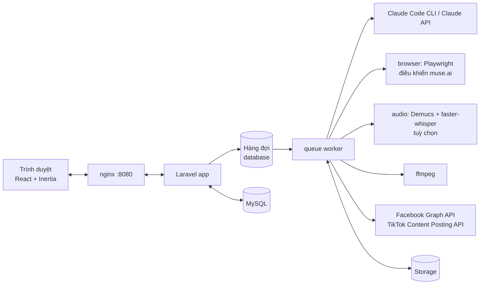
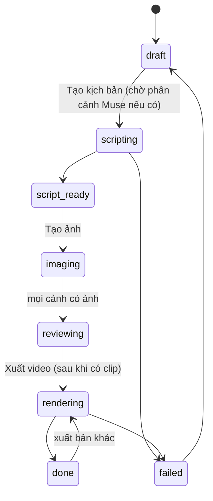

# Tài liệu thiết kế: Video Aff

Cập nhật: 2026-10-12. Thay bản MVP ngày 2026-10-09 (ảnh tĩnh + fal). Tính năng phim hoạt hình đang thiết kế ở [phim-hoat-hinh.md](phim-hoat-hinh.md), danh sách việc ở [tasks.md](tasks.md).

## 1. Mục tiêu

Web giúp người bán làm video affiliate Shopee dọc 9:16 (20–30 giây) cho sản phẩm thời trang, chạy ngầm từ đầu đến cuối:

- **Claude** (gói Pro/Max qua Claude Code CLI, hoặc API) đọc sản phẩm, viết hook, kịch bản, prompt, caption đăng bài.
- **muse.ai** (qua trình duyệt ngầm) lên phân cảnh từ video mẫu + nhạc, tạo ảnh người mẫu mặc sản phẩm và clip chuyển động.
- **ffmpeg** ghép clip, chữ, phụ đề, nhạc thành MP4 1080×1920.
- Đăng video lên **Trang Facebook (Reels)** và **TikTok**.

Nhiều người dùng, trả bằng **Credits** (admin đặt giá, theo chi phí AI thật).

## 2. Luồng người dùng

1. **Sản phẩm:** bấm bookmark "Lấy từ Shopee" trên trang sản phẩm Shopee; job tải ảnh, Claude rút giá, size, chất liệu, đánh giá.
2. **Người mẫu** (đã có đồng ý), **bối cảnh** (ảnh nền thật, tuỳ chọn), **video mẫu** và **nhạc** (tuỳ chọn).
3. Tạo **dự án video**: chọn sản phẩm (một hoặc nhiều bộ), người mẫu, kiểu tiếng (chỉ nhạc / người mẫu nói review / hát nhép), kiểu chuyển động, một cảnh quay liền hay nhiều cảnh. Tick **Chạy ngầm** để app tự làm hết.
4. **Phân cảnh Muse** (khi có video mẫu / nhạc): Muse xem, nghe rồi trả danh sách shot 2–30 giây.
5. **Kịch bản:** Claude viết 5 hook, các cảnh theo phân cảnh, quay toàn thân; người dùng sửa được.
6. **Ảnh cảnh** → **clip chuyển động** (Muse) → **xuất video** (chọn hook, nhạc).
7. **Đề xuất caption** (3 bán hàng, 3 câu view) → **đăng Facebook / TikTok** (hoặc tải MP4). Luôn bật nhãn nội dung AI.

## 3. Kiến trúc

Dịch vụ Docker: `app` (PHP-FPM), `queue` (1 worker), `nginx`, `db` (MySQL), `browser` (Playwright, muse.ai, tối đa `MUSE_MAX_TABS` tab), `audio` (phân tích giọng hát, tuỳ chọn), `node` (Vite).

- Mọi việc gọi ngoài chạy trong job. Việc lâu (Muse tạo ảnh / clip / phân tích) theo kiểu **gửi rồi hỏi lại**: job gửi yêu cầu kèm mã `VA-XXXXXX`, nhả hàng đợi (`release`), lần sau hỏi kết quả theo mã. Nhờ vậy một worker chạy song song nhiều việc.
- Trang dự án tự làm mới (poll) khi có job chạy.
- Ảnh, video, nhạc lưu qua disk `MEDIA_DISK` (mặc định `public`).

## 4. Mô hình dữ liệu (chính)

| Bảng | Vai trò |
| --- | --- |
| `users` | Tài khoản, quyền admin, bị khoá, số dư Credits |
| `products`, `product_images`, `product_categories` | Sản phẩm, ảnh, loại sản phẩm (cách mặc, kiểu chuyển động hợp) |
| `fashion_models`, `backgrounds`, `sample_videos`, `audio_tracks` | Thư viện đầu vào; video mẫu có phân tích chuyển động, nhạc có lời / phân tích giọng hát |
| `video_projects` | Dự án: trạng thái, cài đặt (tiếng, chuyển động, quay liền), `script`, `muse_plan`, `post_captions`, chạy ngầm |
| `scenes`, `scene_images` | Cảnh (thời lượng, góc quay, bộ đồ, prompt, clip, các đoạn của shot dài) và các lần tạo ảnh |
| `renders` | Các bản MP4 đã xuất |
| `muse_analyses` | Kho mọi lần Muse phân tích (prompt, câu trả lời gốc, kết quả, đầu vào) để xây bộ skill viết prompt |
| `social_accounts`, `social_posts` | Trang Facebook / tài khoản TikTok đã kết nối (mã lưu mã hoá) và các lần đăng |
| `ai_usage_logs`, `credit_transactions`, `app_settings` | Chi phí AI từng lần gọi, sổ Credits, cài đặt hệ thống (giá, model) |

## 5. Trạng thái `video_projects`

`autopilot` (chạy ngầm) tự đi tiếp từng bước; bấm lại thì tạo lại các clip lỗi.

## 6. Jobs

| Job | Việc |
| --- | --- |
| `ImportProductJob` | Tải ảnh Shopee, Claude rút thông tin sản phẩm |
| `AnalyzeSampleVideoJob` | Dò shot, phân tích chuyển động video mẫu |
| `AnalyzeVocalsJob` | Tách giọng, ghi lời có mốc thời gian (dịch vụ `audio`, chỉ khi bấm) |
| `PlanWithMuseJob` | Muse lên phân cảnh từ video mẫu + nhạc + ảnh sản phẩm (3–30 phút); lưu vào `muse_analyses` |
| `GenerateScriptJob` | Claude viết kịch bản theo phân cảnh, quy tắc quay toàn thân, kiểu tiếng |
| `GeneratePostCaptionsJob` | Claude viết caption đăng bài (bán hàng / câu view) |
| `GenerateSceneImageJob` | Muse tạo ảnh cảnh (người mẫu + sản phẩm + bối cảnh) |
| `GenerateSceneClipJob` | Muse làm clip từ ảnh cảnh; shot dài làm nhiều đoạn nối khung cuối rồi ghép |
| `RenderVideoJob` | ffmpeg ghép MP4, xong thì viết caption nếu chưa có |
| `PublishFacebookReelJob`, `PublishTikTokJob` | Đăng video, hỏi lại đến khi nền tảng xử lý xong |

## 7. Tích hợp ngoài

**Claude.** `SCRIPT_DRIVER`: `claude_cli` (Claude Code CLI bằng gói Pro/Max, đăng nhập trên giao diện, mọi tool tắt), `claude` (API), `web` (dán tay claude.ai), `fake` (test). Đầu ra JSON theo schema. Model chọn theo thao tác (admin). Chi phí ghi `ai_usage_logs` và trừ Credits.

**muse.ai qua trình duyệt ngầm.** `MUSE_DRIVER=browser`: dịch vụ `browser` đăng nhập muse.ai bằng tài khoản người vận hành (OTP), mỗi yêu cầu mở đoạn chat phụ mới. Loại việc: `image` (ảnh kèm ảnh tham chiếu), `clip` (video từ ảnh, có thể kèm đoạn nhạc), `text` (phân tích, trả JSON). Điều khoản của Meta không cho phép truy cập tự động, nên tài khoản có thể bị giới hạn và bước tự động có thể hỏng khi muse.ai đổi giao diện. Muse đôi khi dừng chờ người duyệt ("Một nhiệm vụ cần xem xét"); app không tự duyệt thay.

**ffmpeg.** H.264 + AAC, 1080×1920, 30 fps, phụ đề `.ass` font tiếng Việt, chuyển cảnh nối liền.

**Facebook.** Graph API: đăng nhập lấy mã Trang (quyền `pages_show_list`, `pages_read_engagement`, `pages_manage_posts`), đăng Reels (3–90 giây).

**TikTok.** Login Kit (PKCE) + Content Posting API: đăng thẳng (chọn quyền xem, bình luận / duet / stitch, công khai nội dung thương mại, nhãn AI) hoặc gửi vào hộp nháp. App chưa được TikTok kiểm duyệt chỉ đăng được ở chế độ riêng tư.

**Trang công khai** `/privacy`, `/terms`, `/data-deletion` cho Meta / TikTok duyệt app.

## 8. Cấu hình (`.env`)

| Biến | Ý nghĩa |
| --- | --- |
| `SCRIPT_DRIVER`, `ANTHROPIC_API_KEY`, `CLAUDE_CODE_OAUTH_TOKEN`, `CLAUDE_MODEL`, `CLAUDE_CLI_MODEL` | Claude |
| `MUSE_DRIVER`, `MUSE_BROWSER_URL`, `MUSE_BROWSER_TOKEN`, `MUSE_BROWSER_TIMEOUT`, `MUSE_CLIP_TIMEOUT` | muse.ai |
| `AUDIO_ANALYZER_URL`, `AUDIO_ANALYZER_TOKEN` | Dịch vụ `audio` |
| `FACEBOOK_APP_ID`, `FACEBOOK_APP_SECRET` | Đăng Facebook |
| `TIKTOK_CLIENT_KEY`, `TIKTOK_CLIENT_SECRET` | Đăng TikTok (Sandbox: mã bắt đầu `sb`) |
| `APP_URL`, `CONTACT_EMAIL` | Địa chỉ công khai (https khi đăng nhập TikTok), email trên trang chính sách |
| `MEDIA_DISK`, `QUEUE_CONNECTION` | Lưu file, hàng đợi |

Khoá chỉ nằm trong `.env`, không commit. Mã truy cập mạng xã hội lưu mã hoá trong DB.

## 9. Quy định và an toàn

- Không xoá dữ liệu người dùng khi sửa lỗi; sao lưu DB trước mỗi migration (`storage/backups`).
- Người mẫu phải có `consent_at`. Mọi cảnh quay toàn thân, lịch sự, không gợi cảm.
- Không bịa thông tin sản phẩm, không nhắc giá / khuyến mãi; caption không bịa trải nghiệm.
- Video có người do AI tạo: bật nhãn AI khi đăng (TikTok gắn tự động khi đăng thẳng).
- Thao tác tốn Credits (tạo ảnh, clip, phân tích) chỉ chạy khi người dùng bấm hoặc bật chạy ngầm.
