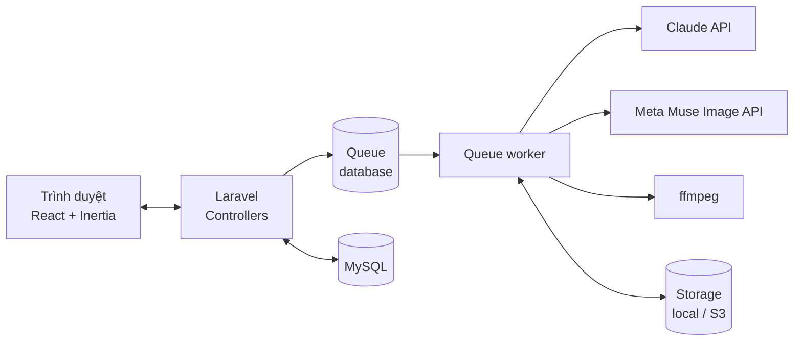
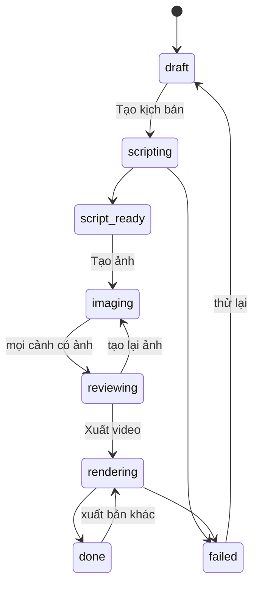

# Tài liệu thiết kế: Video Aff

Cập nhật: 2026-10-09. Bản phân tích gốc (có chi phí, rủi ro): [Claude Doc](https://claude.ai/code/artifact/5708d9e0-0766-40e6-b80a-f5abe67c4e21).

## 1. Mục tiêu

Web nội bộ giúp làm video affiliate Shopee (9:16, 20–30 giây) cho sản phẩm thời trang từ 3 đầu vào: link Shopee, ảnh sản phẩm, ảnh người mẫu.

- Claude viết hook, kịch bản, lời đọc, caption.
- Meta Muse Image mặc sản phẩm lên ảnh người mẫu cho từng cảnh.
- Máy chủ ghép ảnh thành video có chuyển động (zoom/lướt), chữ, phụ đề, nhạc.

**Ngoài phạm vi MVP:** tự lấy dữ liệu từ Shopee (Shopee chặn), clip chuyển động AI (Muse Video chưa có API), giọng đọc AI, đăng video tự động.

## 2. Luồng người dùng

1. Tạo **sản phẩm**: dán link Shopee, tải 2–5 ảnh (ít nhất 1 ảnh nền trắng), nhập giá, size, chất liệu, vài đánh giá.
2. Chọn **người mẫu** trong thư viện (ảnh toàn thân, đã có giấy đồng ý).
3. Bấm **Tạo kịch bản**: Claude trả về 3 hook + 6–7 cảnh (mô tả hình, chữ trên màn, lời đọc, prompt ảnh, thời lượng). Người dùng sửa trực tiếp.
4. Bấm **Tạo ảnh**: mỗi cảnh gọi Muse Image một lần.
5. **Duyệt ảnh**: giữ ảnh đúng sản phẩm, bấm tạo lại ảnh sai (có thể sửa prompt).
6. Bấm **Xuất video**: chọn hook, nhạc; máy chủ render MP4 1080×1920.
7. Tải MP4, đăng Shopee Video và **bật nhãn AI**.

## 3. Kiến trúc

- Mọi lời gọi API ngoài và render chạy trong **job** (dịch vụ `queue` trong Docker), không chặn request web.
- Trang dùng Inertia polling (`router.reload` mỗi vài giây) để hiện trạng thái job. Có thể thay bằng Laravel Reverb sau.
- Ảnh và video lưu qua `Storage` (disk `public` khi chạy local, S3/R2 khi triển khai).

## 4. Mô hình dữ liệu

| Bảng | Cột chính | Ghi chú |
| --- | --- | --- |
| `products` | `user_id`, `shopee_url`, `name`, `price`, `details` (json: size, chất liệu, màu), `reviews` (text) | Dữ liệu người dùng nhập |
| `product_images` | `product_id`, `path`, `is_primary` | Ảnh nền trắng đánh dấu `is_primary` |
| `fashion_models` | `user_id`, `name`, `photo_path`, `consent_at` | Không cho dùng nếu `consent_at` rỗng |
| `video_projects` | `product_id`, `fashion_model_id`, `status`, `script` (json), `selected_hook`, `music`, `error` | Trạng thái ở mục 5 |
| `scenes` | `video_project_id`, `position`, `duration_ms`, `visual`, `on_screen_text`, `voiceover`, `image_prompt` | Tách từ `script` để sửa từng cảnh |
| `scene_images` | `scene_id`, `path`, `status` (`pending`/`ready`/`approved`/`rejected`/`failed`), `provider_request_id`, `cost_usd` | Mỗi lần tạo lại là một dòng mới |
| `renders` | `video_project_id`, `hook`, `path`, `status`, `duration_ms` | Một dự án có nhiều bản (A/B hook) |

Tên model Eloquent dùng `FashionModel` để tránh trùng nghĩa với "model" của Laravel.

## 5. Trạng thái `video_projects`

## 6. Jobs và services

| Job | Việc | Gọi |
| --- | --- | --- |
| `GenerateScriptJob` | Gửi thông tin + ảnh sản phẩm cho Claude, lưu `script`, tạo `scenes` | `ScriptWriter` |
| `GenerateSceneImageJob` | Ảnh người mẫu + ảnh sản phẩm + `image_prompt` → 1 ảnh cảnh | `ImageGenerator` |
| `RenderVideoJob` | Ghép ảnh đã duyệt thành MP4 | `VideoRenderer` |

Services trong `app/Services`, đăng ký qua service container để đổi nhà cung cấp mà không sửa job:

- `ScriptWriter` → `ClaudeScriptWriter`.
- `ImageGenerator` (interface) → `MetaMuseImageGenerator`, `FalMuseImageGenerator`. Chọn bằng `MUSE_DRIVER`.
- `VideoRenderer` → `FfmpegVideoRenderer`.

Job đặt `$tries = 3`, `$backoff` tăng dần, `$timeout` 600 giây cho render. Lỗi cuối cùng ghi vào `video_projects.error`.

## 7. Tích hợp ngoài

### Claude API (kịch bản)

- SDK: `composer require anthropic-ai/sdk` (`Anthropic\Client`).
- Model: `claude-opus-5-5`, đặt trong `config/services.php` (`CLAUDE_MODEL`) để đổi được.
- Đầu ra JSON có cấu trúc qua `outputConfig: ['format' => ...]` (structured outputs), không parse văn bản tự do. Schema: `hooks[3]`, `scenes[]` (`visual`, `on_screen_text`, `voiceover`, `image_prompt`, `duration_ms`), `caption`, `hashtags[]`.
- Gửi kèm ảnh sản phẩm (base64) để Claude mô tả đúng chi tiết.
- System prompt cố định, có các quy tắc: tiếng Việt tự nhiên; không khẳng định điều sản phẩm không ghi ("không lộ", "lụa cao cấp", giá cố định); CTA "xem màu, size, ưu đãi trong giỏ hàng". Đặt `cache_control` cho system prompt.
- Kiểm tra `stop_reason` trước khi đọc nội dung; xử lý lỗi theo lớp exception của SDK (429/5xx thì retry job).

### Meta Muse Image (mặc đồ lên người mẫu)

- Dùng endpoint chỉnh sửa ảnh có nhiều ảnh tham chiếu: qua Meta Model API, hoặc qua fal (`meta/muse-image/edit`). Giá tham khảo 0,01 USD/ảnh ([nguồn](https://runtimewire.com/article/meta-ships-muse-image-api-at-one-cent-per-image), [nguồn](https://letsdatascience.com/news/fal-opens-access-to-meta-muse-image-0fef298a)).
- **Chưa kiểm chứng:** định dạng request/response, số ảnh tham chiếu tối đa, giấy phép thương mại và quy định về ảnh người thật. Đọc tài liệu chính thức khi có khoá API rồi mới cài đặt.
- Ảnh đầu ra 9:16; lưu `provider_request_id` và chi phí từng lần gọi.

### ffmpeg (ghép video)

- Đầu ra: H.264 + AAC, 1080×1920, 30 fps, `-movflags +faststart`.
- Mỗi cảnh: ảnh → clip bằng `zoompan` (zoom chậm hoặc lướt), chuyển cảnh `xfade` ngắn.
- Chữ trên màn và phụ đề: tạo file `.ass` từ `scenes` (đã biết thời lượng từng cảnh), không cần nhận dạng giọng nói. Font hỗ trợ tiếng Việt đặt trong `resources/fonts` (ví dụ Be Vietnam Pro, giấy phép OFL).
- Nhạc nền chọn từ thư viện có bản quyền dùng thương mại, giảm âm lượng.
- Cảnh cuối cố định: bảng size + CTA giỏ hàng.

## 8. Cấu hình (`.env`)

| Biến | Ý nghĩa |
| --- | --- |
| `ANTHROPIC_API_KEY` | Khoá Claude API |
| `CLAUDE_MODEL` | Mặc định `claude-opus-5-5` |
| `MUSE_DRIVER` | `meta` hoặc `fal` |
| `META_API_KEY` / `FAL_KEY` | Khoá theo driver |
| `FILESYSTEM_DISK` | `public` (local) hoặc `s3` |
| `QUEUE_CONNECTION` | `database` |

Khoá chỉ nằm trong `.env` hoặc biến môi trường của máy chủ, không commit.

## 9. Màn hình (Inertia pages)

| Route | Page | Việc |
| --- | --- | --- |
| `GET /products` | `products/index` | Danh sách sản phẩm |
| `GET /products/create` | `products/create` | Nhập link, ảnh, thông tin |
| `GET /models` | `models/index` | Thư viện người mẫu, tải ảnh + xác nhận đồng ý |
| `GET /projects/{id}` | `projects/show` | Kịch bản → ảnh → duyệt → xuất, theo trạng thái |
| `POST /projects/{id}/script` | | Đưa `GenerateScriptJob` vào hàng đợi |
| `POST /scenes/{id}/image` | | Tạo hoặc tạo lại ảnh một cảnh |
| `POST /scene-images/{id}/approve` | | Duyệt ảnh |
| `POST /projects/{id}/render` | | Đưa `RenderVideoJob` vào hàng đợi |

Mọi route nằm sau `auth`; người dùng chỉ thấy dữ liệu của mình (policy theo `user_id`).

## 10. Quy định và an toàn

- Hiện nhắc **bật nhãn AI** ở bước tải video.
- Không cho dùng ảnh người mẫu chưa có `consent_at`.
- Khuyến khích chèn 1–2 clip quay sản phẩm thật (Shopee không khuyến khích video toàn ảnh tĩnh). Giai đoạn 2 cho tải clip thật lên làm cảnh.
- Ghi chi phí mỗi lần gọi API để theo dõi chi tiêu.

## 11. Lộ trình

1. **Giai đoạn 0:** thử Muse bằng tay trên meta.ai với 3–5 sản phẩm. Chỉ làm tiếp nếu Muse giữ đúng sản phẩm.
2. **Giai đoạn 1 (MVP):** mục 2 bước 1–7, theo thứ tự: models + migrations → sản phẩm, người mẫu → kịch bản (Claude) → ảnh (Muse) → render (ffmpeg).
3. **Giai đoạn 2:** giọng đọc tiếng Việt (TTS), clip thật của người dùng, clip chuyển động AI (Kling/Seedance qua fal), 3 bản hook để thử A/B, tiện ích trình duyệt lấy ảnh từ trang Shopee.

## 12. Câu hỏi mở

- Dùng Muse qua Meta Model API hay qua fal?
- Triển khai ở đâu: VPS (cần chạy ffmpeg và queue) hay chỉ chạy trên máy cá nhân?
- Có cần nhiều người dùng không, hay chỉ một tài khoản?
